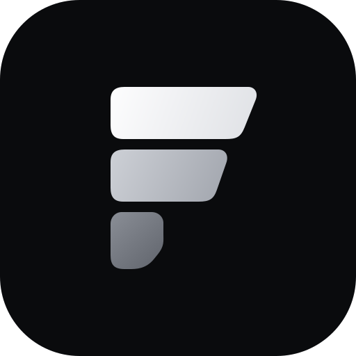

<p align="center"></p>

<h1 align="center">TerminalF</h1>

<p align="center"><a href="README.md">English</a> · Türkçe</p>

Android cihazlar için hızlı, sade bir yönetim ve optimizasyon uygulaması. Root veya Shizuku ile sistem
düzeyinde ayarları tek dokunuşla uygular; oyun performansını, pili ve depolamayı tek yerden yönetmeni sağlar.

Uygulama **İngilizce** açılır; **Türkçe**'ye *Cihaz > Bildirimler ve Uyarılar > Dil* bölümünden (ya da karşılama
ekranından) geçebilirsin. Seçim hatırlanır.

## Özellikler

- **Ana Sayfa** – Anlık CPU, bellek, ısı, pil ve ağ durumu; pil süresi tahmini ve uyarılar.
- **Optimize** – Sistem animasyonları, yenileme hızı, arka plan kısıtlamaları, önbellek temizliği gibi hazır ayarlar.
- **Uygulamalar** – Yüklü uygulamaları listele, dondur, kaldır; sistem için kritik paketler korunur.
- **Oyun** – Oyun başına çözünürlük ölçeği ve FPS hedefi, hazır profiller, oyun gözcüsü ve ısı koruması.
- **Cihaz / Görünüm / Ayarlar** – Cihaz bilgileri, 18 tema (varsayılan: AMOLED siyah), vurgu rengi, renkli arayüz,
  logo rengi (ana ekran simgesi de buna uyar), bildirim ve uyarı ayarları, dil.

## Erişim

Önce root denenir, yoksa Shizuku kullanılır. Hazır olma durumu gerçek bir komutla doğrulanır; başarısız bir işlem
asla başarılı gibi gösterilmez. Ağa veri gönderilmez, telemetri yoktur.

## Kurulum ve güncelleme

APK'yı [Releases](../../releases) sayfasından indirip kur. Sonraki sürümler **silip yeniden kurmadan**, mevcut
uygulamanın üzerine güncellenir; GitHub adresinden güncelleme yapan herhangi bir uygulamaya (ör. Obtainium)
bu deponun bağlantısını vermen yeterli.

Üst üste güncellemenin çalışması için iki şey sabit tutulur:

- **Aynı imza:** Her sürüm aynı anahtarla imzalanır. Anahtarı ilk derlemede GitHub Actions kendisi üretir ve `signing-keys` dalına kaydeder; sonraki derlemeler onu kullanır. Bu dalı silme.
- **Artan sürüm numarası:** `versionCode` her derlemede otomatik olarak büyür (dakika bazlı), elle artırmak gerekmez.

`applicationId` değerini (`com.example.terminal_flutter`) değiştirme; değişirse Android bunu yeni bir uygulama sayar.

## Derleme

```
./gradlew :app:testDebugUnitTest      # birim testleri
./gradlew :app:assembleDebug          # debug APK
./gradlew :app:assembleRelease        # imzalı release APK
```

Gereksinimler: JDK 17, Android SDK 35. `main` dalına yapılan her push; test çalıştırır, imzalı APK üretir ve
otomatik olarak yeni bir Release yayınlar (`.github/workflows/build.yml`). Commit mesajına `[minor]` veya
`[major]` yazarak sürümü büyütebilirsin.

Release derlemesi için elle bir ayar gerekmez. İstersen kendi anahtarını `KEYSTORE_BASE64` adlı GitHub secret'ı
olarak ekleyebilirsin; tanımlıysa o kullanılır (anahtarı bir kez seçtikten sonra değiştirme).

## Logo ve simgeler

Logo; koyu yuvarlatılmış bir karo üzerinde, beyazdan griye geçen üç çubuklu bir "F"dir (`icon.svg`). Simgeleri
`python3 tools/gen_logo_assets.py` ve `python3 tools/gen_launcher_icons.py` ile yeniden üretebilirsin
(ortak geometri `tools/logo_common.py`; Pillow ve numpy gerekir).

## Çeviriler

Metinler kodun yanında `tr("English", "Türkçe")` biçiminde durur (bkz. `core/I18n.kt`); `app/src/main/assets/config/`
altındaki JSON dosyaları isteğe bağlı `titleEn` / `descriptionEn` alanları taşır. Yeni dil eklemek için `AppLanguage`
ve `tr` yardımcısı genişletilir.

## Gereksinimler

minSdk 24, targetSdk 34.

## Lisans

[LICENSE](LICENSE) dosyasına bakın.
